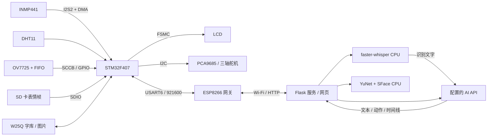

# 系统框架

## 主控调度

`User/main.c` 建立时钟、串口和外设，再在循环中服务到期任务。TIM6 的 1ms 中断提供毫秒计数，DMA/串口中断只完成采样与收字节等短工作。前台用 `Tick/Poll`、截止时间和 busy 标志交接任务，没有操作系统线程、信号量或 RTOS 互斥锁。

录音、拍照、OTA、字库更新使用协作占用规则避让；显示切片在允许时执行。任务必须及时返回，阻塞的外设调用仍可能拖慢其他任务。Python 的线程锁与板端 busy 标志是两种不同机制。

## 语音流向

麦克风持续采样，DMA 每约 32ms 提供一个完成半块。`miclink` 依据 RMS、连续超阈值次数及静音持续时间决定起录/断句；`micaud` 将两半块拼为 2048 字节并放发送环。ESP 接收后使用 RAM/Flash 缓冲及网络发送泵，将 PCM 交给服务端。

服务端边收边落 WAV，完整性检查通过后进入单消费者识别队列；faster-whisper 在上位机执行。识别完成后手动确认或自动把文本送入 AI 决策链。当前并非逐字流式 ASR：录制与上传可以重叠，但识别等待完整句子，AI 回复也有网络耗时。

## 相机流向

网页创建任务，ESP 轮询领取，F407 采集 FIFO 一帧，经串口送 ESP，再上传服务端。服务端校验大小/CRC、保存图片，后台做人脸检测/比对，并按视场角计算目标偏差。当前是按请求拍照；不是实时视频，也未把人脸坐标自动闭环为舵机持续跟随。

## 动作与界面

管理员档案提供三轴限位、回正及速度。AI 上下文读取当前档案；时间线编译器把动作展开为板端步骤，设备按全局时基执行。姿态回传是软件估计值，网页 3D 用其显示。屏幕像素主要来自 SD，W25Q 保存扩展字库；片内 Flash 保存代码和 OTA 镜像。
